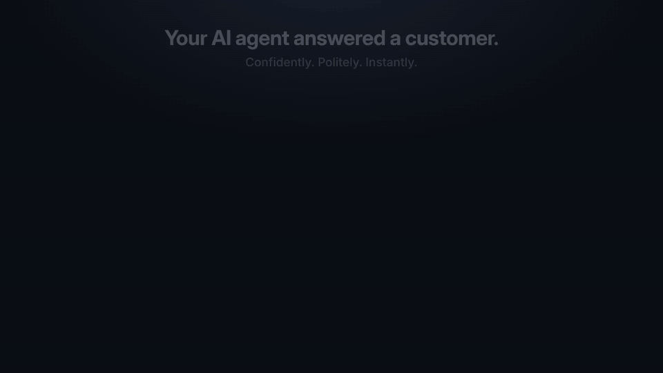
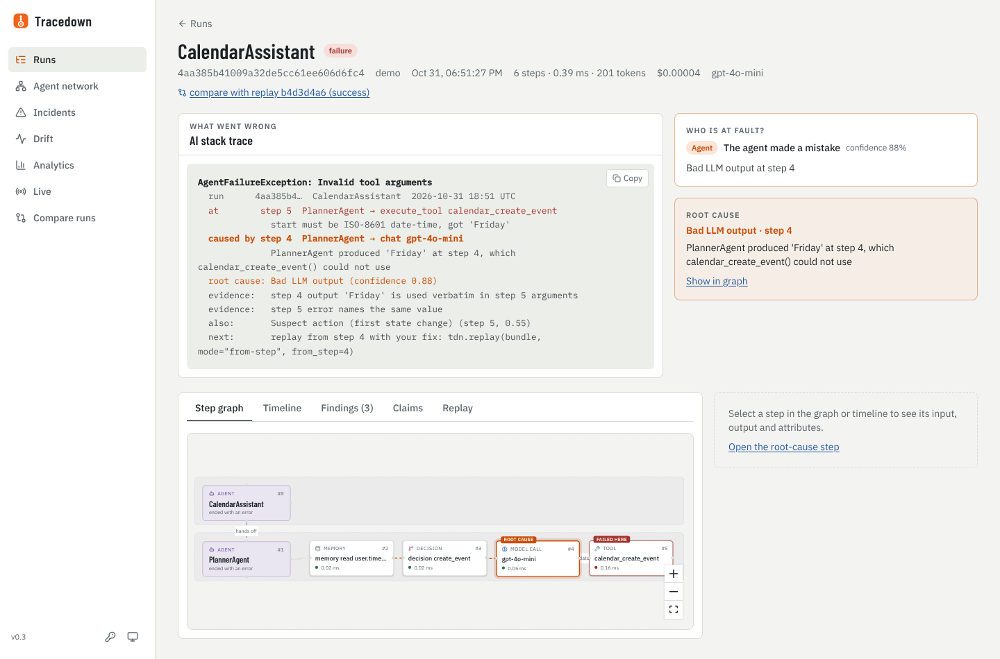
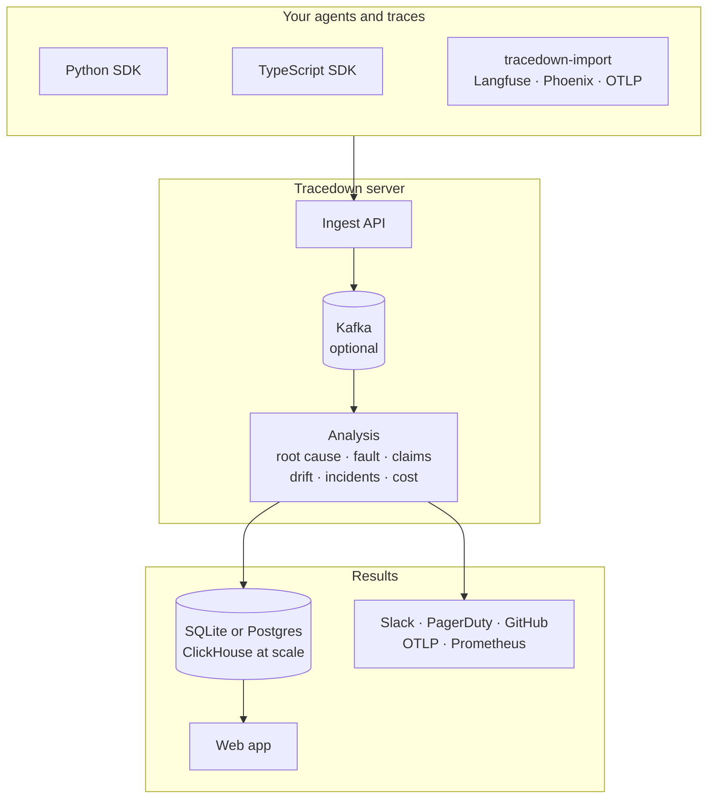
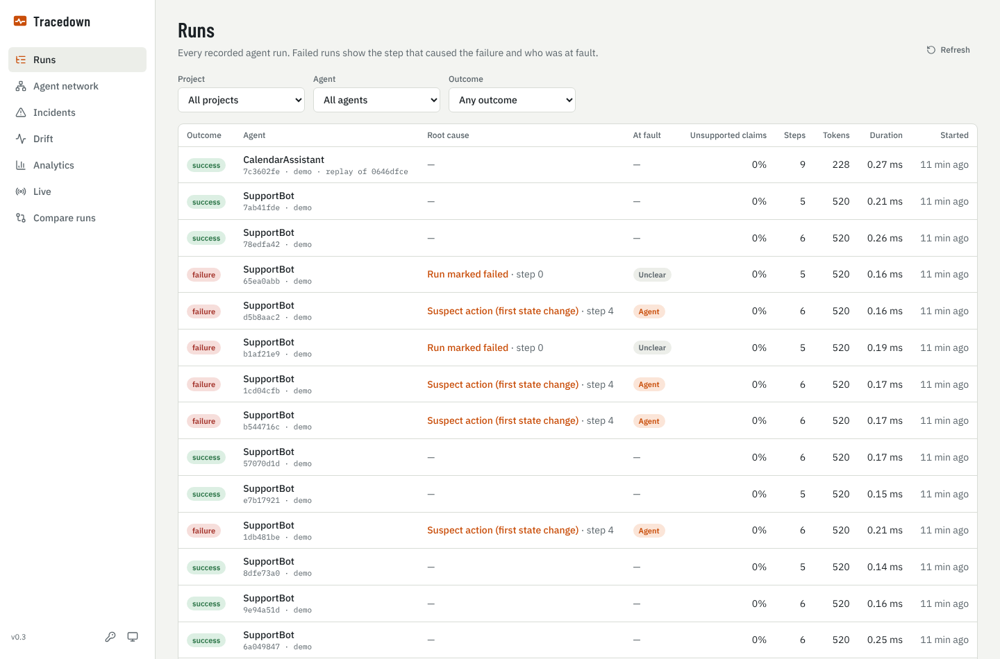
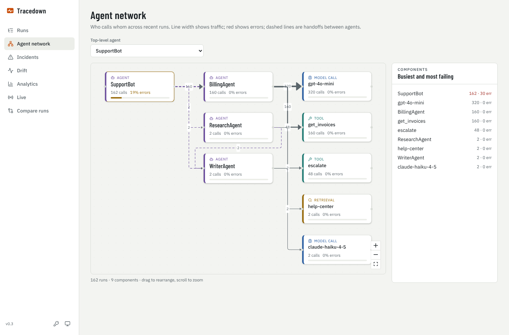
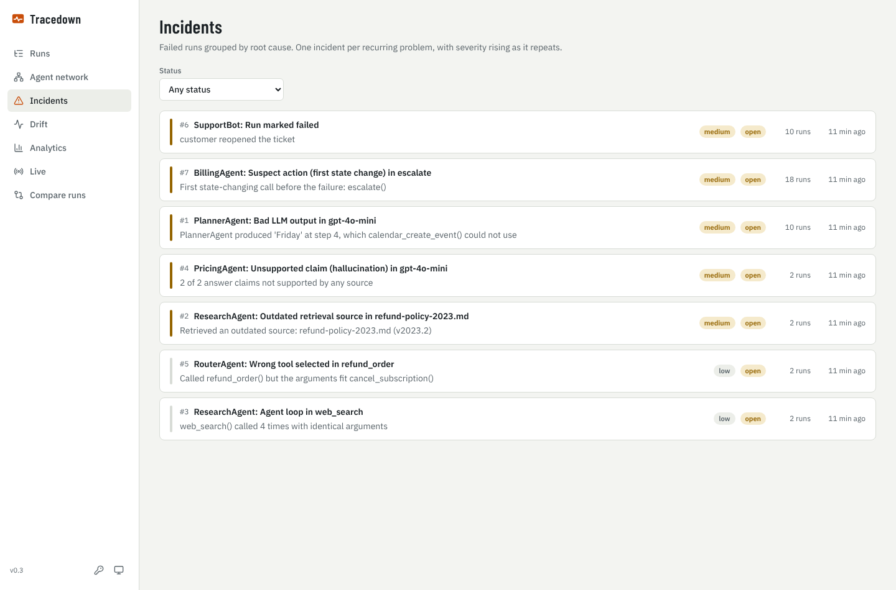
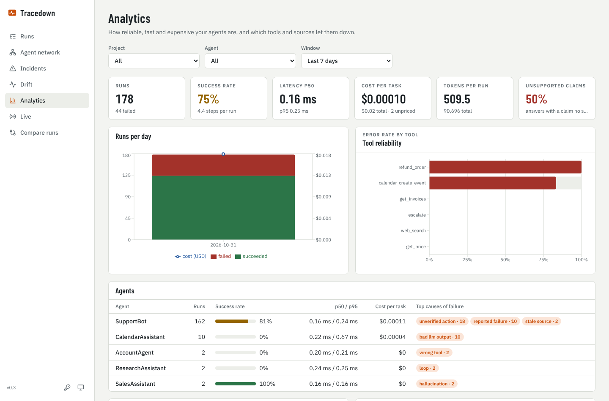
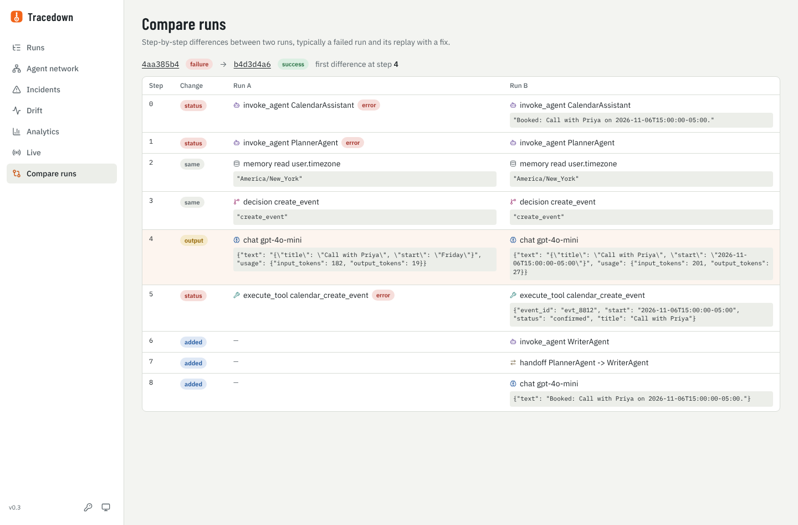
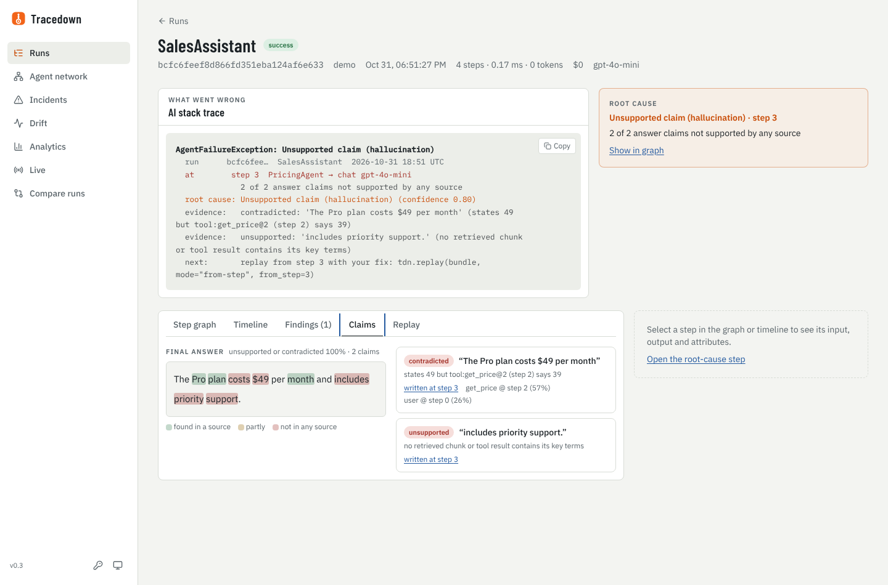

<div align="center">

<picture>
  <source media="(prefers-color-scheme: dark)" srcset="docs/brand/logo-dark.svg">
  
</picture>

### Find the step that caused your AI agent's failure.

Your tracing tool shows what your agent did. Tracedown tells you which step broke it, shows the evidence, and replays the run with your fix. Open source, and it works on top of the traces you already have.

[](https://github.com/nbn07/agent-tracedown/actions/workflows/ci.yml)
[](https://pypi.org/project/agent-tracedown-server/)
[](https://www.npmjs.com/package/agent-tracedown)
[](sdk/python)
[](LICENSE)

**Works with** LangGraph · CrewAI · OpenAI Agents · Claude Agent SDK · Google ADK · Pydantic AI · Vercel AI SDK · MCP · Langfuse · Arize Phoenix · OpenTelemetry

[Quick start](#quick-start) · [How it works](#how-it-works) · [Integrations](#integrations) · [Benchmarks](#benchmarks) · [Comparison](#comparison) · [Docs](docs/)



<sub>A real run from <a href="server/tracedown_server/demo/agents.py"><code>tracedown_server/demo/agents.py</code></a>. Every verdict shown is Tracedown's actual output. <a href="docs/demo/demo.mp4">Watch in HD</a>.</sub>

</div>

## Why Tracedown

AI agents rarely crash. They fail quietly: a model writes "Friday" where a date belongs, a retriever returns last year's policy, a loop burns forty tool calls. Tracing tools record every step, and then leave you to work out which one broke the run.

Tracedown is the flight recorder that also reads the recording. It walks back from the symptom to the step that caused it, and shows the evidence.

- **Works with what you have.** Import failed runs from Langfuse, Arize Phoenix or any OpenTelemetry exporter with no code changes, or add one line to [13 frameworks](#integrations).
- **Explains the failure.** The root cause, the evidence, and a verdict on who was at fault: the agent, or the user.
- **Replays with your fix.** Earlier steps come from the recording; from the broken step on, the agent runs live with your change. Needs a run recorded with the SDK.
- **Runs without an LLM.** Diagnosis is rules first: instant, free and private. An inexpensive LLM judge is optional.
- **Measured.** Accuracy on a public, human-labelled benchmark is [published](#benchmarks), losses included.
- **Free and self-hosted.** Apache-2.0, every feature, including SSO, roles, audit log and scale-out storage.

## Quick start

**See it work.** Eight agents fail in realistic ways, from a stale document to a prompt injection, and Tracedown diagnoses each one. No API key, server or Docker needed.

```bash
pip install agent-tracedown-server
git clone https://github.com/nbn07/agent-tracedown && python agent-tracedown/examples/run_demo.py
```

**Diagnose the runs you already have.** No code changes. A [5-minute tutorial](docs/tutorials/langfuse.md) walks through it.

```bash
export LANGFUSE_PUBLIC_KEY=pk-lf-... LANGFUSE_SECRET_KEY=sk-lf-...
tracedown-import langfuse --errors-since 24h      # failed runs from the last day
tracedown-import otlp traces.json --failed        # or any OpenTelemetry export
```

Imported runs get the full diagnosis. Replay needs a run recorded with one of the SDKs below, because it runs your agent's own code.

**Instrument your own agent.** The SDKs have no dependencies.

```python
import agent_tracedown as tdn                     # pip install agent-tracedown
tdn.init(project="support-bot", endpoint="http://localhost:7070")

with tdn.run("CalendarAssistant", input=message) as run:
    reply = tdn.llm_call(call_model, model="gpt-4o-mini", prompt=messages)
    tdn.tool_call("create_event", args, create_event, schema=SCHEMA)
    run.output(reply)
```

<details>
<summary>TypeScript</summary>

```ts
import * as tdn from "agent-tracedown";           // npm install agent-tracedown
tdn.init({ project: "support-bot", endpoint: "http://localhost:7070" });

await tdn.run("CalendarAssistant", { input: message }, async run => {
  const reply = await tdn.llmCall(callModel, { model: "gpt-4o-mini", prompt: messages });
  await tdn.toolCall("create_event", args, createEvent, { schema: SCHEMA });
  run.output(reply);
});
```

The TypeScript and Python SDKs record the same data, and the same run gets the same diagnosis from either.

</details>

**Open the web app.** Runs, step graphs, incidents, drift and analytics, from the repository you cloned above:

```bash
cd agent-tracedown/deploy && docker compose up -d   # web app on :3000, API on :7070
```

Without Docker, run `tracedown-server --db tracedown.db` and then `cd web && npm install && npm run dev`.

## How it works

| 1. Record | 2. Diagnose | 3. Replay |
|---|---|---|
| Every step of a run: model calls, tools, retrievals, memory and hand-offs. Or imported from your existing traces. | Walk back from the symptom to the root cause, with evidence, and decide who was at fault. | Re-run from the broken step with your fix. Earlier steps come from the recording, so nothing happens twice. |

[How Tracedown decides](docs/HOW-IT-DECIDES.md) walks through each stage, with its limits. Every failed run gets an AI stack trace you can paste into an issue:

```
AgentFailureException: Invalid tool arguments
  at        step 5  PlannerAgent → execute_tool calendar_create_event
              start must be ISO-8601 date-time, got 'Friday'
  caused by step 4  PlannerAgent → chat gpt-4o-mini
              PlannerAgent produced 'Friday' at step 4, which calendar_create_event() could not use
  root cause: Bad LLM output (confidence 0.88)
  evidence:   step 4 output 'Friday' is used verbatim in step 5 arguments
  next:       replay from step 4 with your fix: tdn.replay(bundle, mode="from-step", from_step=4)
```

Beyond single runs, Tracedown checks each claim in an answer against its sources, compares runs across prompt and model versions, groups failures into incidents with Slack, PagerDuty or GitHub alerts, and shows cost per run, step, model and agent.

<p align="center"></p>

## Integrations

| Framework | One line |
|---|---|
| LangChain, LangGraph | `graph.invoke(x, config={"callbacks": [tdn_lc.callback("MyGraph")]})` |
| OpenAI Agents SDK | `tdn_oa.instrument()` |
| Claude Agent SDK | `async for m in tdn_claude.trace_stream(query(prompt=p, options=o), name="Agent")` |
| Google ADK | `App(name="support", root_agent=agent, plugins=[tdn_adk.TracedownPlugin()])` |
| Pydantic AI | `result = await tdn_pai.run(agent, prompt)` |
| MCP clients | `tdn_mcp.instrument(client)` |
| CrewAI | `tdn_crew.instrument()` |
| AutoGen AgentChat | `async for m in tdn_ag.trace_stream(team.run_stream(task=t), name="Team")` |
| Semantic Kernel | `tdn_sk.instrument(kernel)` |
| LlamaIndex | `tdn_li.instrument()` |
| OpenAI and Anthropic clients | `tdn.plugins.instrument("openai", client)` |
| Vercel AI SDK (TypeScript) | `generateText({ model: traceModel(model), tools: traceTools(tools) })` |
| OpenAI Agents SDK (TypeScript) | `await instrument()` from `agent-tracedown/openai-agents` |
| Existing traces | Langfuse, Arize Phoenix, OpenInference, OpenLLMetry, any OTLP exporter |

<details>
<summary>Tested versions</summary>

Each adapter is tested in CI against the real library: LangGraph 1.2, openai-agents 0.24, claude-agent-sdk 0.2, google-adk 2.13, pydantic-ai 2.64, mcp 1.30 and 2.3, CrewAI 1.15, AutoGen 0.7, Semantic Kernel 1.46, LlamaIndex 0.14, Vercel AI SDK 5 to 7, and @openai/agents 0.21. Python adapters live in `agent_tracedown.integrations`.

</details>

Tracedown also exports: OTLP to Jaeger, Tempo, Datadog or any collector, and Prometheus metrics at `/metrics`.

## Benchmarks

[Who&When](realworld/whowhen/README.md) (ICML 2025) asks which step caused each of 184 failed multi-agent runs, labelled by people. Exact match, one run, no tuning on this data:

| Right step | First guess<br/><sub>algorithm · hand-crafted</sub> | In top three<br/><sub>algorithm · hand-crafted</sub> |
|---|---|---|
| **Tracedown with an LLM judge** (Claude Haiku 5.5) | **36.5% · 20.7%** | **50.8% · 32.8%** |
| Tracedown, rules only | 21.4% · 19.0% | 33.3% · 31.0% |
| Baseline: first failure-looking output | 23.0% · 15.5% | – |
| Baseline: random step | 12.0% · 4.2% | 36.0% · 12.5% |
| Best GPT-4o method in the paper | 16.6% · 8.8% | – |

The first guess is wrong more often than it is right, so treat it as the first place to look and check the evidence. On the algorithm-generated set, rules alone do no better than a random pick within the top three; the judge is what lifts it. [How Tracedown decides](docs/HOW-IT-DECIDES.md) explains the method and where it fails.

On [τ-bench](realworld/README.md) failures, Tracedown's first guess ties a simple rule ("blame the first database change") at 74%, and its top three contain the right step 81% of the time. It used to lose 68% to 74%; the fix was found on the development split and scored once on the test split. The method and every change after the first scoring are in [LABELING.md](realworld/LABELING.md). The judge's answers are saved in the repository, so re-scoring needs no API key.

## Comparison

Tracedown is a root-cause layer that works alongside your tracing tool, not a replacement for it.

| | Open source | Explains why a run failed | Replays from a step with a fix | Published accuracy | Works without an LLM |
|---|---|---|---|---|---|
| **Tracedown** | Apache-2.0, every feature | Yes | Yes | Yes | Yes |
| [AgentDebugX](https://github.com/AgentDebugX/AgentDebugX) | MIT | Yes, with a proposed fix | Yes, after approval | Yes | Partly |
| [Comet Opik](https://github.com/comet-ml/opik) | Apache-2.0 core | Yes, with a suggested fix | Reruns failing inputs | No | No |
| [Laminar](https://laminar.sh) | Yes | Pattern search in plain English | Yes | No | Search uses an LLM |
| [Arize Phoenix](https://github.com/Arize-ai/phoenix) | Elastic License 2.0 | Through an AI assistant | Model calls only | No | No |
| [TraceRoot](https://github.com/traceroot-ai/traceroot) | Apache-2.0 core | Yes, against your source code | No | No | No |
| [Langfuse](https://langfuse.com) | MIT core | No | No | – | – |
| LangSmith, Arize AX, Galileo | Commercial | Yes | Not documented | No | No |

AgentDebugX is the closest project. Scored the same way on Who&When (agent and step both right, all 184 runs), Tracedown with a Claude Haiku 5.5 judge reaches 31.5% and AgentDebugX with Qwen 3.5 9B reaches 28.8%; the models differ, so neither is a clear winner.

<sub>Based on each project's documentation, the <a href="https://arxiv.org/abs/2607.18754">AgentDebugX paper</a> and <a href="https://arize.com/resources/best-ai-agent-debugging-tools/">Arize's 2026 comparison</a>, October 2026. Something out of date? <a href="https://github.com/nbn07/agent-tracedown/issues/new">Open an issue</a>.</sub>

## Architecture



It starts as one process on SQLite and scales out with Postgres, Redis, Kafka and ClickHouse. A Helm chart is included.

<details>
<summary>Deployment layouts</summary>

| Layout | Metadata | Spans | Ingest | For |
|---|---|---|---|---|
| One process | SQLite | SQLite | In-process | A laptop, a demo, one team |
| Standard (Compose or Helm) | Postgres | Postgres | In-process, Redis cache | Most teams |
| Scale (Compose or Helm) | Postgres | ClickHouse, routed by project | Kafka and workers | High volume, data residency |

```bash
helm install tracedown deploy/helm/tracedown
```

</details>

<details>
<summary>Screenshots</summary>

| | |
|---|---|
|  |  |
| Runs, with root cause, fault and cost | Agent network with hand-offs and error rates |
|  |  |
| Incidents grouped by root cause | Analytics: success, latency, cost, tool reliability |
|  |  |
| Replay: the original run and the fix | Claims checked against their sources |

</details>

**Documentation:** [How it decides](docs/HOW-IT-DECIDES.md) · [Deployment](docs/DEPLOYMENT.md) · [Configuration](docs/CONFIGURATION.md) · [Design](docs/DESIGN.md) · [Langfuse tutorial](docs/tutorials/langfuse.md) · [Python SDK](sdk/python/README.md) · [TypeScript SDK](sdk/typescript/README.md) · [Telemetry spec](spec/)

## Roadmap

- **Hosted demo**, to try Tracedown without installing anything
- **Proven fixes:** suggest a fix, replay the run with it, and show that it now passes
- **MCP server**, to ask "why did run X fail?" from Claude Code, Cursor or any MCP client
- **GitHub Action** that runs your agent's test conversations on every pull request
- **Write-back to Langfuse and Phoenix**, so the verdict appears in the tool you already use

Ideas are welcome in [Discussions](https://github.com/nbn07/agent-tracedown/discussions); requests with a real failing run behind them get priority.

## Using Tracedown?

If Tracedown found a bug for you, or you run it at work, say so in [Show and tell](https://github.com/nbn07/agent-tracedown/discussions/categories/show-and-tell). With your permission your team's name goes here. It is the most useful thing you can do for the project after reporting a wrong diagnosis.

## Contributing

The most valuable contribution is a run Tracedown diagnoses wrongly: [report a wrong diagnosis](https://github.com/nbn07/agent-tracedown/issues/new?template=wrong-diagnosis.yml) and it becomes a benchmark case that every later version is tested against. Detectors, framework adapters and documentation are welcome too. Start with [CONTRIBUTING.md](CONTRIBUTING.md) or an issue labelled [good first issue](https://github.com/nbn07/agent-tracedown/labels/good%20first%20issue). Questions go to [Discussions](https://github.com/nbn07/agent-tracedown/discussions).

```bash
pip install -e ./sdk/python -e "./server[dev]" && pytest
```

## License

Apache-2.0, all of it: the SDKs, the server, the root-cause engine, the web app and the enterprise features. There is no paid edition.
