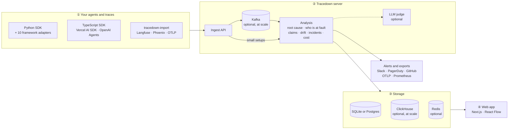

<div align="center">

# Tracedown

### Your agent said "Booked!" Nothing was booked. Tracedown tells you why.

**The open-source flight recorder for AI agents.** It finds the step that *caused* a failure, says whether the agent or the user was at fault, and replays the run with your fix.

[](https://github.com/nbn07/agent-tracedown/actions/workflows/ci.yml)
[](LICENSE)
[](sdk/python)
[](sdk/typescript)
[](#-proof-not-promises)
[](#-quick-start)

[Quick start](#-quick-start) · [How it compares](#-how-tracedown-compares) · [Benchmarks](#-proof-not-promises) · [Integrations](#-works-with-your-stack) · [Roadmap](#-roadmap) · [Contributing](#-contributing)


<sub>A real run from <a href="examples/demo_agents.py"><code>examples/demo_agents.py</code></a>; every verdict shown is Tracedown's actual output. <a href="docs/demo/demo.mp4">Watch in HD</a></sub>

</div>

```bash
git clone https://github.com/nbn07/agent-tracedown && cd agent-tracedown
pip install ./sdk/python ./server && python examples/run_demo.py
```

<sub>About 15 seconds on a laptop. Five agents fail in realistic ways and Tracedown diagnoses each one. No API key, no server, no Docker.</sub>

---

## 😩 The problem

AI agents don't crash. They fail **quietly**:

- A model writes `"Friday"` where a date belongs. The calendar API rejects it **three steps later**.
- A retriever returns **last year's refund policy**. The answer sounds confident, and it's wrong.
- A loop burns **40 tool calls** searching for something that isn't there.
- The run "succeeds", but books the **wrong flight**.

Tracing tools show you all 40 steps. Then **you** have to work out which one broke it. That's like a smoke alarm that tells you the house is full of smoke, but not where the fire started.

## ✨ The solution

Tracedown is the **detective that reads the recording**. It works in three steps:

| 1. Record | 2. Diagnose | 3. Replay |
|---|---|---|
| Every step of every run: model calls, tools, retrievals, memory, hand-offs. Or import the runs you already have in Langfuse, Phoenix or OpenTelemetry | Walks back from the symptom to the **root cause**, shows the evidence, and says **who was at fault**: the agent, or the user | Re-run the failure from the broken step **with your fix**. Earlier steps come from the recording, so nothing gets booked twice |

Every failed run gets an **AI stack trace** you can paste into an issue:

```
AgentFailureException: Invalid tool arguments
  run      895d4127…  CalendarAssistant  2026-10-31 13:52 UTC
  at        step 5  PlannerAgent → execute_tool calendar_create_event
              start must be ISO-8601 date-time, got 'Friday'
  caused by step 4  PlannerAgent → chat gpt-4o-mini
              PlannerAgent produced 'Friday' at step 4, which calendar_create_event() could not use
  root cause: Bad LLM output (confidence 0.88)
  evidence:   step 4 output 'Friday' is used verbatim in step 5 arguments
  evidence:   step 5 error names the same value
  next:       replay from step 4 with your fix: tdn.replay(bundle, mode="from-step", from_step=4)
```

## 🚀 Why developers pick Tracedown

- **🔌 Sits on top of what you already use.** Point it at the runs you already have in Langfuse, Arize Phoenix or any OpenTelemetry exporter, with no code changes. Or add one line to [13 frameworks](#-works-with-your-stack).
- **📏 Measured, not just claimed.** Its accuracy on a public, human-labelled benchmark is published, including where simple rules beat it, and you can re-check it without an API key.
- **🧠 Works without an LLM.** The diagnosis is rules first: instant, free, private, and it runs on your laptop. An inexpensive judge model is optional and makes it sharper.
- **⚖️ "Who is at fault?"** Many "agent failures" are the user's: a wrong order number, an account that doesn't exist. Tracedown gives a verdict on every failed run.
- **⏪ Replay with a fix.** Swap the prompt, the model or the code, then re-run from the broken step and compare the two runs side by side.
- **💸 Cost in dollars.** Every run, step, model and agent, with current Anthropic, OpenAI and Google prices built in.
- **🆓 Everything free.** Apache-2.0, self-hosted, no paid tier, no license key, enterprise features included (SSO, roles, audit log, PII policies, scale-out storage).

## 🥊 How Tracedown compares

Automatic diagnosis of agent failures is no longer rare, and several of the projects below are bigger and more polished. Tracedown's aim is narrower: an **open, measured root-cause layer** that works on top of whichever tracing tool you already use. Based on each project's own documentation, October 2026:

| | Open source | Explains why a run failed | Replay from a step with a fix | Published diagnosis accuracy | Works without an LLM |
|---|---|---|---|---|---|
| **Tracedown** | ✅ Apache-2.0, every feature | ✅ | ✅ | ✅ [Who&When](realworld/whowhen/README.md) | ✅ (LLM judge optional) |
| [Comet Opik](https://github.com/comet-ml/opik) | Apache-2.0 core | ✅ with a suggested fix | Reruns with the failing inputs | Not published | ❌ |
| [Laminar](https://laminar.sh) | ✅ | Pattern search you describe in plain English | ✅ | Not published | Search is LLM-based |
| [Langfuse](https://langfuse.com) | MIT core | No automatic diagnosis (chat assistant, cloud only) | ❌ | n/a | n/a |
| [Arize Phoenix](https://github.com/Arize-ai/phoenix) | Elastic License 2.0 | On demand, through an AI assistant | Model calls only | Not published | ❌ |
| [AgentDebugX](https://github.com/AgentDebugX/AgentDebugX) | ✅ MIT | ✅ with a proposed fix | ✅ reruns with the fix, after an approval gate | ✅ Who&When (28.8% agent+step, all 184 runs) | Partly (rule packs; diagnosis uses an LLM) |
| [TraceRoot](https://github.com/traceroot-ai/traceroot) | Apache-2.0 core | ✅ against your source code | ❌ | Not published | ❌ |
| LangSmith, Arize AX, Galileo | ❌ commercial | ✅ | Not documented | Not published | ❌ |

**Use Tracedown *with* these tools, not instead of them.** Keep Langfuse or Phoenix for tracing, prompts and evaluations, and run `tracedown-import` on the failures. **AgentDebugX is the closest project**: it also publishes Who&When results. Measured the same way (agent and step both right, all 184 runs), Tracedown with a Claude Haiku 5.5 judge scores 31.5% and AgentDebugX's DeepDebug scores 28.8% with Qwen 3.5 9B. That's the same ballpark, with different models, so neither is a clear winner. Sources: each project's documentation, the [AgentDebugX paper](https://arxiv.org/abs/2607.18754) and [Arize's 2026 comparison](https://arize.com/resources/best-ai-agent-debugging-tools/). Something out of date? [Open an issue](https://github.com/nbn07/agent-tracedown/issues/new) and it will be corrected.

## 📊 Proof, not promises

**[Who&When](realworld/whowhen/README.md)** (ICML 2025) is the standard benchmark for "which step caused this failure?". It has 184 failed multi-agent runs, labelled by people. Scoring is exact match, run once, with no tuning on this data:

| Found the exact step that caused the failure | Algorithm-generated logs | Hand-crafted logs |
|---|---|---|
| **Tracedown + LLM judge** (Claude Haiku 5.5) | **36.5%** | **20.7%** |
| Tracedown, rules only (no model, free) | 21.4% | 19.0% |
| Simple rule: first failure-looking output | 23.0% | 15.5% |
| The paper's GPT-4o methods (best in each column, without ground truth) | 16.6% | 8.8% |

These are honest numbers on a hard problem, losses included:
- **τ-bench** ([499 real customer-service failures](realworld/README.md)): a simple rule, "blame the first database change", beats Tracedown's first guess (74% vs 68%). Tracedown's top three suspects contain the right step 81% of the time, and the benchmark's own labels looked questionable in about half of a 50-run spot check.
- **Re-check every number yourself:** the method and every change after the first scoring are in [LABELING.md](realworld/LABELING.md). The judge's answers are saved in the repo, so re-scoring needs no API key.

## ⚡ Quick start

Pick the path that fits. Each one takes under 5 minutes.

### A. See it work (1 minute, nothing to set up)

```bash
git clone https://github.com/nbn07/agent-tracedown && cd agent-tracedown
pip install ./sdk/python ./server
python examples/run_demo.py
```

### B. Diagnose the runs you already have (2 minutes, no code changes)

```bash
export LANGFUSE_PUBLIC_KEY=pk-lf-... LANGFUSE_SECRET_KEY=sk-lf-...   # LANGFUSE_HOST for self-hosted
tracedown-import langfuse --errors-since 24h        # every run with an error in the last day
tracedown-import otlp traces.json --failed          # any OpenTelemetry export (GenAI, OpenInference, OpenLLMetry)
```

Sample exports to try are in [`examples/imports/`](examples/imports/).

For a full 5-minute walkthrough (sample export, real Langfuse keys, reading the stack trace, optional server and judge) see [Diagnose your Langfuse failures in 5 minutes](docs/tutorials/langfuse.md).

### C. Instrument your own agent (3 minutes)

<table>
<tr><th>Python</th><th>TypeScript</th></tr>
<tr><td>

```python
import agent_tracedown as tdn
tdn.init(project="support-bot",
         endpoint="http://localhost:7070")

with tdn.run("CalendarAssistant", input=msg) as run:
    out = tdn.llm_call(call_model,
                       model="gpt-4o-mini",
                       prompt=messages)
    tdn.tool_call("create_event", args,
                  create_event, schema=SCHEMA)
    run.output(answer)
```

</td><td>

```ts
import * as tdn from "agent-tracedown";
tdn.init({ project: "support-bot",
           endpoint: "http://localhost:7070" });

await tdn.run("CalendarAssistant", { input: msg },
  async run => {
    const out = await tdn.llmCall(callModel,
      { model: "gpt-4o-mini", prompt: messages });
    await tdn.toolCall("create_event", args,
      createEvent, { schema: SCHEMA });
    run.output(answer);
  });
```

</td></tr>
</table>

Both SDKs have no dependencies, record the same data, and get the same diagnosis: the tests check this against a real server.

### D. Open the web app (5 minutes, with Docker)

```bash
cd deploy && docker compose up -d     # web app on :3000, API on :7070
```

Or without Docker: `tracedown-server --db demo.db`, then `python examples/run_demo.py --endpoint http://localhost:7070` and `cd web && npm install && npm run dev`.

<p align="center"></p>

## 🧩 Works with your stack

| Framework | One line |
|---|---|
| LangChain / LangGraph | `graph.invoke(x, config={"callbacks": [tdn_lc.callback("MyGraph")]})` |
| OpenAI Agents SDK | `tdn_oa.instrument()` |
| Claude Agent SDK | `async for m in tdn_claude.trace_stream(query(prompt=p, options=o), name="CodingAgent")` |
| Google ADK | `App(name="support", root_agent=agent, plugins=[tdn_adk.TracedownPlugin()])` |
| Pydantic AI | `result = await tdn_pai.run(agent, prompt)` |
| MCP clients | `tdn_mcp.instrument(client)` or `tdn_mcp.instrument_all()` |
| CrewAI | `tdn_crew.instrument()` |
| AutoGen AgentChat | `async for m in tdn_ag.trace_stream(team.run_stream(task=t), name="Team")` |
| Semantic Kernel | `tdn_sk.instrument(kernel)` |
| LlamaIndex | `tdn_li.instrument()` |
| OpenAI / Anthropic clients | `tdn.plugins.instrument("openai", client)` |
| Vercel AI SDK (TS) | `generateText({ model: traceModel(model), tools: traceTools(tools), ... })` |
| OpenAI Agents SDK (TS) | `await instrument()` from `agent-tracedown/openai-agents` |
| **Already tracing?** | Langfuse, Arize Phoenix / OpenInference, OpenLLMetry, any OTLP exporter: `tracedown-import`, or send OTLP to `POST /v1/traces` |

<details>
<summary>Tested versions and imports</summary>

Python adapters live in `agent_tracedown.integrations` (`langchain`, `openai_agents`, `claude_agent`, `google_adk`, `pydantic_ai`, `mcp`, `crewai`, `autogen`, `semantic_kernel`, `llamaindex`). Each one is tested in CI against the real library:
- LangGraph 1.2, openai-agents 0.24, claude-agent-sdk 0.2, google-adk 2.13, pydantic-ai 2.64;
- mcp 1.30 and 2.3, CrewAI 1.15, AutoGen 0.7, Semantic Kernel 1.46, LlamaIndex 0.14.

The TypeScript integrations are tested against Vercel AI SDK 5, 6 and 7 and @openai/agents 0.21.

Adapters observe the framework. Replay substitutes outputs for calls that go through `tdn.llm_call` / `tdn.tool_call`, an instrumented model client, or (in TypeScript) a model wrapped with `traceModel`.

</details>

Tracedown also **sends** data out: OTLP to Jaeger, Tempo, Datadog or any collector (`tdn.OtlpHttpExporter`, or `TDN_OTLP_FORWARD` on the server), and Prometheus metrics at `/metrics`.

## 🎯 Use cases

| You are… | Tracedown helps you… |
|---|---|
| **Debugging a failure a user reported** | Paste the run id and get the root cause, the evidence and the step to replay from, instead of reading 40 steps by hand |
| **Shipping a prompt or model change** | Drift reports compare runs across prompt versions, models, tool schemas or knowledge-base snapshots, and flag what got worse |
| **On call for an agent in production** | Incidents group runs by root cause with severity and a suggested fix, and notify Slack, PagerDuty or GitHub Issues |
| **Fighting hallucinations in a RAG app** | Each claim in an answer is linked to its source and labelled supported, partial, stale, unsupported or contradicted |
| **Running a multi-agent system** | The agent network shows hand-offs and error rates, and the diagnosis names which agent went wrong |
| **Triaging support escalations** | "Who is at fault?" separates agent bugs from user mistakes before an engineer looks |
| **Watching spend** | Cost per run, per step, per model and per agent per day, in dollars |
| **Already on Langfuse or Phoenix** | Keep them. Import the failures and get root causes on top |

## 📚 Examples

| Example | What it shows |
|---|---|
| [`examples/run_demo.py`](examples/run_demo.py) | Five agents that fail in realistic ways (bad model output, stale source, loop, hallucination, wrong tool), plus a prompt-drift cohort |
| [`examples/demo_agents.py`](examples/demo_agents.py) | The agents themselves: a good template for instrumenting your own |
| [`sdk/typescript/examples/demo.ts`](sdk/typescript/examples/demo.ts) | The same agents in TypeScript |
| [`examples/imports/`](examples/imports/) | Sample Langfuse and OpenTelemetry exports to try `tracedown-import` on |
| [`realworld/`](realworld/) | Real failures from public benchmarks, with the scripts that score Tracedown on them |

**Replay a failure with your fix:**

```python
bundle = tdn.fetch_bundle("http://localhost:7070", trace_id)
with tdn.replay(bundle, mode="from-step", from_step=4):
    calendar_agent(extractor=fixed_extractor)   # steps 0-3 come from the recording; step 4 on runs live
```

Modes: `exact` (everything from the recording), `from-step`, `swap` (a new model or prompt) and `full` (everything live). The web app shows the two runs side by side.

## 🏗️ Architecture



It starts as **one process on SQLite** and grows with you:

| Layout | Metadata | Spans | Ingest | For |
|---|---|---|---|---|
| One process | SQLite | SQLite | in-process | a laptop, a demo, one team |
| Standard (Compose or Helm) | Postgres | Postgres | in-process, Redis cache | most teams; several API replicas |
| Scale (Compose `--profile scale` or Helm) | Postgres | ClickHouse, one or more clusters routed by project | Kafka + workers | high span volume, data residency |

```bash
helm install tracedown deploy/helm/tracedown     # add --set redpanda.enabled=true,clickhouse.enabled=true for the scale layout
```

Guides: [Deployment](docs/DEPLOYMENT.md) · [Configuration](docs/CONFIGURATION.md) · [Design](docs/DESIGN.md) · [Telemetry spec](spec/)

<details>
<summary>📸 More screenshots</summary>

| | |
|---|---|
|  |  |
| **Runs**, with root cause, fault and cost | **Agent network** with hand-offs and error rates |
|  |  |
| **Incidents** grouped by root cause | **Analytics**: success, latency, cost, tool reliability |
|  |  |
| **Replay diff**: the original run and the fix | **Claims**: each sentence checked against its source |

</details>

## 🗺️ Roadmap

**Shipped in v0.3:** Python and TypeScript SDKs · 13 framework integrations · Langfuse and OTel import · root-cause engine with an optional LLM judge · "who is at fault" · replay · claims checking · drift · incidents · dollar costs · web app · Postgres, Redis, Kafka, ClickHouse, Helm.

**Next:**

- [ ] **`pip install` and `npm install`** from PyPI and npm (packaging is done; publishing is next)
- [ ] **Hosted demo**: click around without installing anything
- [ ] **Proven fixes**: suggest a fix, replay the run with it, and show that it now passes
- [ ] **MCP server**: ask "why did run X fail?" from Claude Code, Cursor or any MCP client
- [ ] **GitHub Action**: run your agent's test conversations on every pull request and block the merge with the root cause
- [ ] **Write-back to Langfuse and Phoenix**: see Tracedown's verdict inside the tool you already use
- [ ] **"Was this diagnosis right?" button**: every answer becomes a new label, so accuracy improves with use
- [ ] **Login and team admin screens** in the web app
- [ ] **More benchmarks**: TRAIL, and results on your real failures

Something missing? [Open an issue](https://github.com/nbn07/agent-tracedown/issues/new/choose). Requests with a real failing run behind them get priority.

## 🤝 Contributing

Tracedown gets better with every failure it sees. The most valuable contributions are, in order:

1. **🐛 A run we diagnose wrongly.** [Report a wrong diagnosis](https://github.com/nbn07/agent-tracedown/issues/new?template=wrong-diagnosis.yml) with the run (redacted) and what really went wrong. Each one becomes a benchmark case, so every later version is tested against it.
2. **🔍 A detector** for a failure pattern we miss: one function in [`rca/detectors.py`](server/tracedown_server/rca/detectors.py), plus a demo agent that triggers it.
3. **🧩 A framework adapter**: copy the nearest one in [`integrations/`](sdk/python/agent_tracedown/integrations/) and test it against the real library.
4. **📝 Docs and examples**: a tutorial for your stack helps the next person more than you'd think.

```bash
pip install -e ./sdk/python -e "./server[dev]" && pytest     # about 150 tests, ~15 seconds
cd sdk/typescript && npm install && npm test                  # TypeScript SDK, incl. end-to-end against the server
```

Read [CONTRIBUTING.md](CONTRIBUTING.md) for the ground rules and repo layout. First time contributing to open source? Issues labelled [`good first issue`](https://github.com/nbn07/agent-tracedown/labels/good%20first%20issue) are a friendly place to start.

## 💬 Community

- **⭐ Star the repo** if Tracedown saved you a debugging session. It's the simplest way to help others find it.
- **🐛 [Issues](https://github.com/nbn07/agent-tracedown/issues)** for bugs, wrong diagnoses and feature requests.
- **📣 Using Tracedown?** Add your project or company to the list below with a pull request, and show it off with a badge:

```markdown
[](https://github.com/nbn07/agent-tracedown)
```

[](https://github.com/nbn07/agent-tracedown)

**Who uses Tracedown:** *your project here. [Add it](https://github.com/nbn07/agent-tracedown/edit/main/README.md).*

## 📜 License

**Apache-2.0, all of it**: the SDKs, the server, the root-cause engine and judge, the importers, the web app and the enterprise features. There is no paid tier, no feature held back and no license key. Use it at work, change it, ship it.

Tracedown also proposes [three additions to the OpenTelemetry GenAI conventions](docs/standards/otel-genai-proposal.md) (decision spans, replay provenance, memory consistency), so the ideas here can become standard for every tool.

<div align="center">
<sub>Built for everyone who has stared at a 40-step trace wondering which step broke it.</sub>
</div>
