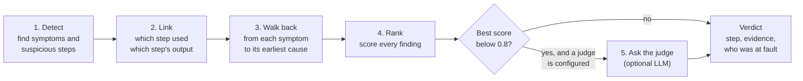

# How Tracedown decides

Tracedown blames a step in your agent's run. Before you trust that, you should know how it got there. This page explains the method, what each verdict is based on, and where it goes wrong.

Think of a car mechanic. The warning light on the dashboard is the *symptom*. A good mechanic does not replace the light. They follow the wires back from it to the part that actually failed. Tracedown does the same with an agent run: it starts from where the failure showed up and follows the data back to the step that caused it.

## 1. Detect

Ten rule-based detectors read the run. Each one looks for one kind of problem and reports a *finding*: the step, a category, a confidence and the evidence it saw.

| Detector | Looks for |
|---|---|
| Tool errors | A tool call that failed, or got arguments its schema rejects |
| Wrong tool | Tool X was called where tool Y fits: the arguments fail X's schema but fit Y's, or the request matches Y's description far better |
| Point of no return | In a failed run, the first call that tried to change something (a refund, a booking). A prime suspect, not proof, so it ranks below direct evidence |
| Loops | The same tool called three or more times with identical arguments, or the step budget exceeded |
| Retrieval quality | A search that returned nothing, or returned sources marked outdated |
| Context window | A prompt that filled 95% or more of the model's context window |
| Memory consistency | A memory read that returns something different from what was written |
| Planning | A decision step that chose an option whose precondition had failed |
| Hallucination | Claims in the answer that no source supports, or that a source contradicts (see [Claims](#claims) below) |
| Run status | The run ended in an error, and no single step failed |

Some detectors need details that the SDKs and framework integrations record, such as the list of tools offered to the model or a flag on outdated documents. Runs imported from other tracers may not carry them, so fewer detectors fire on those.

Some findings are **symptoms** (where the failure showed up, like a tool rejecting a date). Others are **suspects** (steps that look wrong, like a model writing "Friday" where a date belongs).

No model is involved in this step. It is fast, free and gives the same answer every time.

## 2. Link

Tracedown builds a map of which step used which earlier step's output. Step B depends on step A when a value from A's output appears word for word in B's input: an ID, a date, a sentence from a document, a number of 100 or more. Very short or common values ("true", "user") are ignored so they do not create false links.

## 3. Walk back

From each symptom, Tracedown follows the map backwards:

- If an earlier step on that path was flagged as a suspect, the **earliest** one is the root cause. Its evidence gets the line "its output flows into step N, where the failure surfaced".
- If nothing upstream was flagged and a tool failed, Tracedown finds the model step whose value reached the failing tool's arguments. If the tool's error message names that value, confidence is 0.88. Otherwise it is 0.7.
- If the tool's arguments were valid and its error does not mention them (a 500 error, a timeout), the tool or the service behind it is blamed, not the model.

This is the Friday example from the README: the calendar tool failing at step 5 is the symptom, and the model step that wrote "Friday" at step 4 is the cause.

## 4. Rank

Every finding gets a score, starting from its confidence:

| Rule | Effect |
|---|---|
| It is a root cause found by the walk back | × 1.2 |
| It is a symptom with a known cause | × 0.8, so the cause ranks above it |
| A document or memory read that no later step used | × 0.6, since it cannot have caused the failure |
| A wording problem in a run that also changed something (refund, booking) | × 0.7, since the action is the likelier cause |

Scores are capped at 0.99. The top finding is the verdict; the next ones are shown as alternatives. **Scores are rule weights, not calibrated probabilities.** A 0.88 means "strong evidence of this kind", not "88% likely".

## 5. The judge (optional)

Rules cannot tell that the agent refunded the wrong order, or cancelled when the customer asked to change the date. For those, you can turn on a judge model with `TDN_JUDGE` (see [Configuration](CONFIGURATION.md)).

The judge is asked only when the run failed **and** the best rule finding scores below 0.8. It reads a short transcript and the rule findings, then names a step and a reason. Its answer becomes one more finding:

- its confidence is capped at 0.9;
- its evidence says what the rules picked, so you can compare;
- if it blames a model step that proposed a plan, and a later step carried that plan out, the later step is blamed and the evidence says "plan first proposed at step N; carried out at step M".

If the judge is not configured, fails or answers badly, the rules' verdict stands.

In judge mode, the transcript is sent to the model you configure. In rules-only mode nothing leaves your machine.

## Who was at fault

Not every failed run is an agent bug. For a failed run, Tracedown also gives one of three verdicts, using only the trace:

- **agent**: the agent did something wrong, and the findings say where;
- **user**: the user's details never matched an account, or they turned down what was offered and nothing else changed;
- **unfinished**: nothing went wrong yet; the run stopped while the agent was waiting for the user.

When the rules are unsure (confidence below 0.8) and a judge is configured, the judge gets a second look, and the rules' answer is kept alongside its answer.

## Claims

For the final answer, Tracedown checks each claim against its sources:

1. Split the answer into claims (sentences and clauses).
2. Collect the evidence: retrieved documents, successful tool results, memory and the user's own messages, each tagged with its step.
3. Match each claim to its best evidence by shared words, with numbers and names counting double.
4. Label it **supported**, **partial**, **unsupported**, **contradicted** (a close source gives a different number), **stale** (only an outdated source supports it) or **no claim** (pleasantries).
5. Find the earliest model step whose output already contained the claim.

This is how the demo traces "$120" back to an outdated refund policy. Matching is by words, not meaning, so a correct paraphrase can show as partial. A judge can refine partial and unsupported claims.

## Replay

Replay runs your agent again from the blamed step, with your fix. Steps before it come from the recording; from that step on, the agent runs live. Replay runs inside your agent's code through the SDK, so it needs a run recorded with the [Python](../sdk/python/README.md) or [TypeScript](../sdk/typescript/README.md) SDK. Runs imported from Langfuse or OpenTelemetry get the full diagnosis, but cannot be replayed on their own.

Tracedown does not write the fix yet. You write it; replay shows whether it works. Suggested and proven fixes are on the [roadmap](../README.md#roadmap).

## How often it is right

On [Who&When](../realworld/whowhen/README.md), a public benchmark of 184 failed multi-agent runs labelled by people:

| | Right step, first guess | Right step in top three |
|---|---|---|
| With a Claude Haiku 5.5 judge | 36.5% / 20.7% | 50.8% / 32.8% |
| Rules only | 21.4% / 19.0% | 33.3% / 31.0% |

The two numbers are the algorithm-generated and hand-crafted sets. In plain terms: **the first guess is wrong more often than it is right.** Use the verdict as the first place to look, check the evidence, and look at the next two findings if it does not fit. On the hand-crafted set, the top three contain the right step about a third of the time.

The full tables, including baselines, are in the [README](../README.md#benchmarks).

## Where it goes wrong

- **Long multi-agent runs where the mistake is a judgement call.** Most errors in Who&When are of this kind. Rules have little to go on, and the judge is right only some of the time.
- **Values that change shape.** The link step needs exact matches. If a model rewrites "2026-11-06" as "6 November", the link is lost.
- **Paraphrased claims.** Word matching misses claims that are right but worded differently.
- **The first failure is often the answer.** On τ-bench, "blame the first database change" beats Tracedown's first guess (74% to 68%).

If Tracedown blames the wrong step on one of your runs, please [report it](https://github.com/nbn07/agent-tracedown/issues/new?template=wrong-diagnosis.yml). Every report becomes a test case for later versions.
