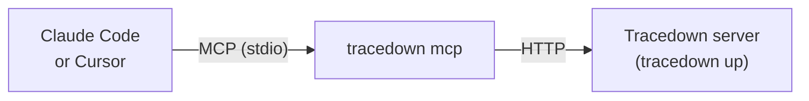

# Ask your coding assistant

`tracedown mcp` runs Tracedown as an [MCP](https://modelcontextprotocol.io) server. Claude Code, Cursor, Claude Desktop and other MCP clients can then answer questions like these, using Tracedown's diagnosis instead of guessing from logs:

- "Which agent runs failed today, and why?"
- "Why did run 71148e02… fail? Show me the step."
- "What should I change, and has a fix been shown to work?"
- "Here's a Langfuse export: what went wrong?"

Think of it as giving your assistant the mechanic's report instead of the raw dashcam footage.



## Set it up

1. Have a Tracedown server running: `tracedown up` on your machine (default `http://127.0.0.1:7070`), or your team's server.
2. Add the MCP server to your client. With [uv](https://docs.astral.sh/uv/) installed, nothing else needs installing:

**Claude Code**

```bash
claude mcp add tracedown -- uvx --from "agent-tracedown-server[mcp]" tracedown mcp
```

**Cursor, Claude Desktop and other clients** (`.cursor/mcp.json`, `claude_desktop_config.json` or your client's MCP settings):

```json
{
  "mcpServers": {
    "tracedown": {
      "command": "uvx",
      "args": ["--from", "agent-tracedown-server[mcp]", "tracedown", "mcp"]
    }
  }
}
```

Without uv: `pip install "agent-tracedown-server[mcp]"`, then use `tracedown` with the args `["mcp"]` as the command.

**Another server:** add `"--endpoint", "https://tracedown.example.com"` to the args. If it needs an API key, set it in the client's `env` as `TDN_API_KEY` (never in the args, which may be logged).

## Tools

| Tool | What it answers |
|---|---|
| `list_failed_runs` | Recent failed runs with the root cause and who was at fault. Filter by agent or project |
| `explain_run` | The AI stack trace, the top suspect with evidence, who was at fault, and the next suspects |
| `get_step` | One step's kind, status, input and output (shortened) |
| `suggest_fixes` | What to change, most likely first, and whether each fix has been tried and worked |
| `check_replay` | Did a replay fix the run? |
| `check_claims` | Each sentence of the final answer against its sources |
| `list_incidents` | Recurring problems: failed runs grouped by the same cause |
| `diagnose_trace` | Diagnose a pasted Langfuse, OpenTelemetry or Tracedown export |

All tools only read, except `diagnose_trace`, which imports the export into the `pasted` project, like "Diagnose a trace" in the web app. `get_step` shows step content, so the API key you give it needs permission to read payloads.

## Good to know

- Verdicts are ranked suspects, not certainties, and the tools say so. A good assistant will quote the evidence and read the step before concluding.
- Fixes are tried inside your agent's code, so the MCP server can't run them. `suggest_fixes` gives the `tdn.try_fixes(...)` line to run where your agent runs; the results then show up in `suggest_fixes` and in the web app.
