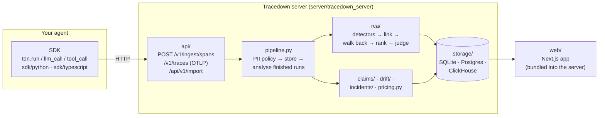

# Architecture Tour

Where everything lives, and what happens to a run from the moment your agent records it to the verdict on screen.

## The journey of one run

Think of a parcel service: your agent hands over parcels (spans), the depot checks and stores them, an inspector examines each finished delivery, and the results go on a board.



1. **Record.** The SDK wraps each model call, tool call, retrieval and memory access in a span with OpenTelemetry `gen_ai.*` attributes plus a few `tdn.*` ones (step number, tool schema, outdated-source flags). Inputs and outputs go into separate blobs, referenced by a digest. When the run ends, the exporter posts everything to the server.
2. **Ingest.** `api/` accepts Tracedown spans, OTLP traces and imports (Langfuse, OpenTelemetry, Tracedown bundles; `importers/detect.py` guesses the format).
3. **Pipeline.** `pipeline.py` applies the project's PII policy, stores spans, publishes live events, and for every finished run: analyses it, groups it into an incident, scans for drift and notifies hooks (Slack, PagerDuty, GitHub).
4. **Analyse.** `rca/engine.py` runs the detectors, builds the data-flow map, walks back from symptoms, ranks findings and, if configured, asks the judge (`rca/judge.py`). `rca/fault.py` decides who was at fault. `claims/` checks each claim of the final answer.
5. **Show.** The web app reads `/api/v1/runs/…`. `tracedown up` serves a static build of it from `tracedown_server/web`.
6. **Replay.** The SDK fetches a run's bundle and re-runs your agent, serving recorded steps from it (`tracer.py`: `replay`, `_Replay`, `_replayable`).

## Map of the repository

| Folder | What's in it | Start reading at |
|---|---|---|
| `spec/` | The telemetry spec (JSON Schema) | `tdn-event.schema.json` |
| `sdk/python/agent_tracedown/` | Python SDK: tracer, exporters, redaction, plugins, framework integrations | `tracer.py` |
| `sdk/typescript/src/` | TypeScript SDK: same data and replay; Vercel AI SDK and OpenAI Agents integrations | `tracer.ts` |
| `server/tracedown_server/api/` | FastAPI app: ingest, runs, analysis, replay, import, web app serving, read-only guard | `__init__.py` |
| `server/tracedown_server/rca/` | The diagnosis | `detectors.py`, then `engine.py` |
| `server/tracedown_server/claims/` | Claim checking ("where each claim came from") | |
| `server/tracedown_server/importers/` | Langfuse, OpenTelemetry, format detection | `detect.py` |
| `server/tracedown_server/demo/` | The eight demo agents and their loader | `agents.py` |
| `server/tracedown_server/storage/` | SQLite and Postgres stores | |
| `server/tracedown_server/enterprise/` | SSO, roles, audit log, PII policy, Kafka queue, ClickHouse | |
| `server/tracedown_server/cli.py` | `tracedown up` and `tracedown demo` | |
| `web/` | Next.js web app (React, Tailwind, React Flow, Recharts) | `app/runs`, `components/runs` |
| `benchmark/` | Synthetic benchmark: generator, data, scorer | `README.md` |
| `realworld/` | Who&When, τ-bench, live harnesses, label checks | `README.md` |
| `deploy/` | Dockerfiles, Compose, Helm chart, the public demo | |
| `docs/` | The documentation site (MkDocs), published by `docs.yml` | `HOW-IT-DECIDES.md` |
| `.github/workflows/` | `ci`, `release`, `docs`, `images`, `integration`, `judge-benchmark` | `ci.yml` |

## Shapes worth knowing

**A span** (what the SDK sends):
```json
{"trace_id": "…", "span_id": "…", "parent_span_id": "…", "name": "execute_tool calendar_create_event",
 "kind": "tool", "status": {"code": "ERROR", "message": "start: not a date-time"},
 "attributes": {"tdn.step": 5, "gen_ai.tool.name": "calendar_create_event", "tdn.tool.args_valid": false},
 "input_digest": "sha256:…", "output_digest": null}
```
Kinds: `agent`, `llm`, `tool`, `retrieval`, `memory`, `handoff`, `decision`.

**A finding** (what a detector returns, `rca/detectors.py: Finding`):
```json
{"category": "bad_llm_output", "label": "Bad LLM output", "step": 4,
 "title": "PlannerAgent produced 'Friday' at step 4, which calendar_create_event() could not use",
 "evidence": ["step 4 output 'Friday' is used verbatim in step 5 arguments", "step 5 error names the same value"],
 "confidence": 0.88, "symptom": false, "caused_by": null}
```

## Scaling up

One process on SQLite is the default. The same code scales out: Postgres for metadata, Redis for the cache and live feed, Kafka with `tracedown-worker` for ingest, ClickHouse for spans. See [Deployment](https://nbn07.github.io/agent-tracedown/DEPLOYMENT/) and [Configuration](https://nbn07.github.io/agent-tracedown/CONFIGURATION/).
