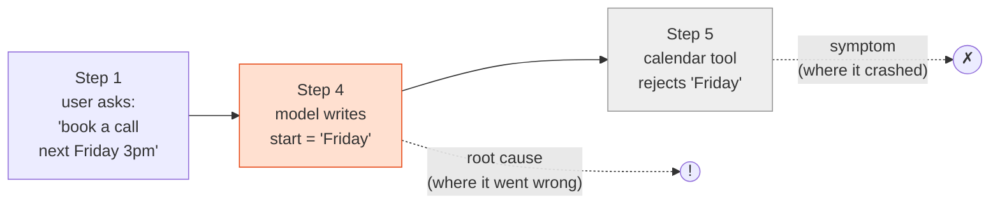
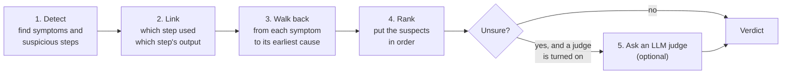
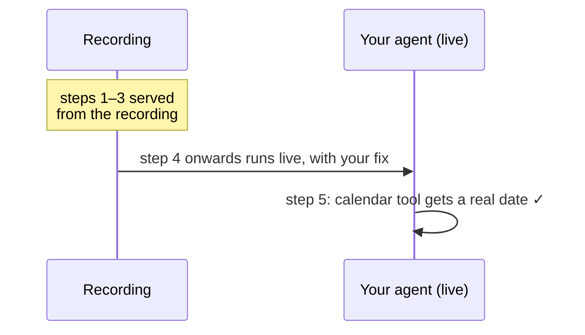

# How Tracedown Works

This page explains the method in plain words. The full reference, with every rule and number, is [How Tracedown decides](https://nbn07.github.io/agent-tracedown/HOW-IT-DECIDES/) on the documentation site.

## The idea in one picture

An agent run is a chain of steps: the model thinks, calls a tool, reads a document, thinks again, answers. When the run fails, the step that *crashed* is usually not the step that was *wrong*.

The calendar tool failed at step 5, but it did its job: "Friday" is not a date. The mistake was made at step 4, when the model wrote "Friday" instead of "2026-11-06T15:00". Tracedown points at step 4 and says why: *step 4's output "Friday" is used word for word in step 5's arguments, and step 5's error names that value.*

## Five stages

Like a detective: collect clues, connect them, follow the trail back, rank the suspects, and, for hard cases, ask an expert.

1. **Detect.** Eleven small rules ("detectors") each look for one kind of problem: a tool error, the same call repeated, an outdated document, a claim with no source, text that tries to give the model orders. No model is involved, so this is free, fast and gives the same answer every time.
2. **Link.** Tracedown builds a map of which step used which earlier step's output, by finding exact values (an ID, a date, a sentence) that travel from one step to another.
3. **Walk back.** From each symptom, it follows the map backwards to the earliest suspicious step.
4. **Rank.** Every finding gets a score. Scores only put suspects in order; they are **not** the chance of being right, so the app shows "top suspect" rather than a percentage.
5. **Judge (optional).** For runs the rules are unsure about, you can turn on an LLM judge (`TDN_JUDGE`). It reads a short transcript and names a step. Without it, nothing leaves your machine.

## What you get for a failed run

| You see | Everyday version |
|---|---|
| **Root cause** | "The fault is in this part" |
| **Evidence** | "Here's what I measured," in words you can check |
| **Who was at fault** | The agent, the user (for example, wrong account details), or nobody yet (the run stopped while waiting) |
| **Claims checked** | Every sentence of the answer next to the source it came from, or a flag saying there is none |
| **Replay** | Run it again from the broken step with your fix; earlier steps come from the recording |

## Replay: a test drive with the new part

Replay re-runs your agent from the blamed step. Steps before it are served from the recording, so they cost nothing and can't change. From that step on, your agent runs live with your fix.

Replay needs a run recorded with the Python or TypeScript SDK, because it runs inside your code. Runs imported from Langfuse or OpenTelemetry get the full diagnosis but can't be replayed on their own.

**Coming in v0.5 ([Roadmap](Roadmap)):** after a replay, Tracedown checks whether the fix worked: the blamed problem is gone, nothing new broke, the run finished, and your own test passed. `tdn.confirm_cause()` uses the same check to prove the blamed step really was the cause.

## Where it goes wrong

Tracedown is honest about its limits. Its first guess is wrong more often than it is right on hard public benchmarks; see [Accuracy and Benchmarks](Accuracy-and-Benchmarks). Treat a verdict as **the first place to look**, and check its evidence.
