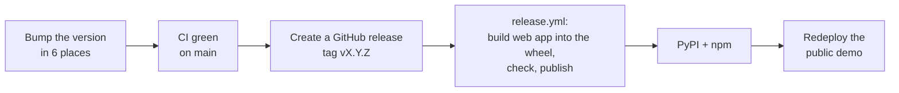

# Release Process

For maintainers. Three packages ship together, always with the same version number:

| Package | Registry | Folder |
|---|---|---|
| `agent-tracedown` | PyPI | `sdk/python` |
| `agent-tracedown-server` | PyPI | `server` |
| `agent-tracedown` | npm | `sdk/typescript` |

Publishing uses **trusted publishing**: no tokens are stored anywhere. One-time setup is in [`RELEASING.md`](https://github.com/nbn07/agent-tracedown/blob/main/RELEASING.md).

## Each release

1. **Bump the version** to the same value in all six places:
   - `sdk/python/pyproject.toml` and `SDK_VERSION` in `sdk/python/agent_tracedown/tracer.py`
   - `server/pyproject.toml` and `__version__` in `server/tracedown_server/__init__.py`
   - `sdk/typescript/package.json` and `sdk/typescript/src/version.ts`
2. **Update** the README or docs if behaviour changed, and `deploy/demo/Dockerfile` (`ARG TRACEDOWN_VERSION`).
3. **Push to `main`** and wait for CI to pass.
4. **Create the release** on GitHub: **Releases → Draft a new release → Choose a tag → `vX.Y.Z` (create on publish)**. Title `vX.Y.Z: <one-line summary>`, notes in plain words: what's new, what's fixed, how to upgrade. Click **Publish release**.
5. **Watch the `release` workflow** in Actions. It builds the web app into the server wheel, checks the wheel contains it, and publishes to PyPI (environments `pypi`, `pypi-server`) and npm (`npm`). Approve the environments if you set them to need approval.
6. **Check:** `pip install -U agent-tracedown-server && tracedown up` shows the new version in the web app's sidebar.
7. **Redeploy the public demo** on Render (**Manual Deploy → Deploy latest commit**), then check its sidebar shows the new version.

## Versioning

- Patch (0.4.**3**): fixes and wording, no API change.
- Minor (0.**5**.0): new features (for example proven fixes).
- Before 1.0, a minor release may change APIs; say so clearly in the release notes.
