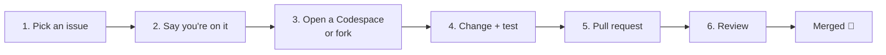

# Your First Contribution

From "I'd like to help" to a merged pull request. No prior open-source experience needed.



## 1. Pick an issue

- Browse [**good first issue**](https://github.com/nbn07/agent-tracedown/issues?q=is%3Aissue+is%3Aopen+label%3A%22good+first+issue%22): small, well-described tasks, each with the files to touch and how to test.
- Or [**help wanted**](https://github.com/nbn07/agent-tracedown/issues?q=is%3Aissue+is%3Aopen+label%3A%22help+wanted%22) for something bigger.
- Have your own idea? Open an issue first, so we can agree on the approach before you write code.

## 2. Say you're on it

Comment "I'd like to work on this" on the issue. That stops two people doing the same work. If you get stuck or busy, just say so; there is no penalty.

## 3. Get the code

**Easiest: Codespaces (in the browser, nothing to install).** On the repository page: **Code → Codespaces → Create codespace**. In about two minutes you have Python, Node and every dependency. See [Development Setup](Development-Setup).

**Or on your own machine:** click **Fork**, then:
```bash
git clone https://github.com/<your-username>/agent-tracedown.git
cd agent-tracedown
git checkout -b fix-issue-123
pip install -e ./sdk/python -e "./server[dev]"
```

## 4. Make the change, and test it

```bash
pytest                                   # about a minute; must pass
cd sdk/typescript && npm test            # only if you touched the TypeScript SDK
```

Add a test for what you changed. For a new detector or a bug in the diagnosis, the test usually runs a small demo agent and checks the verdict (see [Writing a Detector](Writing-a-Detector)).

House rules (short version of [`CONTRIBUTING.md`](https://github.com/nbn07/agent-tracedown/blob/main/CONTRIBUTING.md)):
- The Python SDK stays standard-library only and never raises from telemetry code.
- A changed span attribute also changes `spec/tdn-event.schema.json`.
- Every finding carries evidence a person can check.
- Write docs and messages in plain words.

## 5. Open a pull request

Push your branch and click **Compare & pull request**. Fill in the template: what it changes (link the issue: "Fixes #123") and how you tested it.

**First pull request?** GitHub holds the automated checks until a maintainer clicks "Approve and run". That's normal and usually happens within a day.

## 6. Review

A maintainer will review, usually within a few days. Expect questions or small change requests; that is normal for every pull request, not a sign anything is wrong. Push more commits to the same branch to update it.

If `main` moved on and your branch has conflicts:
```bash
git fetch upstream            # once: git remote add upstream https://github.com/nbn07/agent-tracedown.git
git rebase upstream/main
git push --force-with-lease
```

## After it's merged

You'll be added to the **Contributors** section of the README. Thank you!

## Other ways to help, without code

- [Report a wrong diagnosis](Reporting-a-Wrong-Diagnosis): the most valuable contribution of all.
- Try Tracedown on your own agent and share what confused you in [Discussions](https://github.com/nbn07/agent-tracedown/discussions).
- Fix a typo or an unclear sentence in the docs or this wiki.
- Star the repo, so more people find it.
